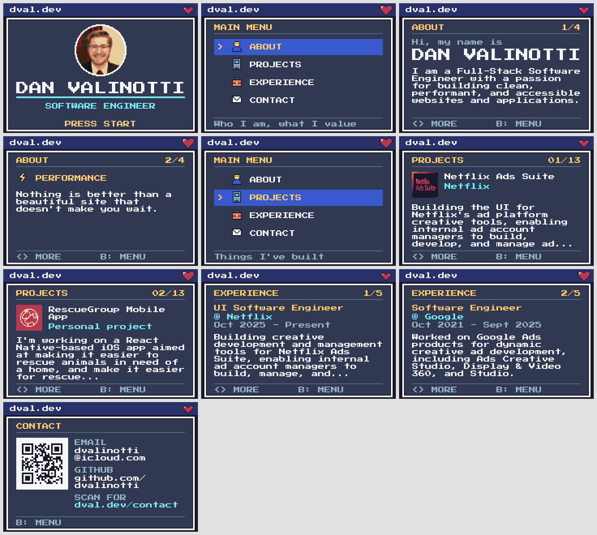

# dval-gba

[dval.dev](https://dval.dev) as a Game Boy Advance cartridge: a pixel-art business card with an about section, a project carousel, work experience and a contact screen. Built with [PocketJS](https://github.com/pocket-nexus/pocketjs) and its MicroTS compiler, which turns a Solid TSX view and a TypeScript model into `no_std` Rust for the GBA's ARM7.



## Controls

| Button | Action |
| --- | --- |
| Start or A | Leave the title screen; open the selected section |
| Up / Down | Move through the main menu |
| Left / Right, L / R | Previous or next page in a section |
| B | Back to the menu (and from the menu, to the title) |

## How it works

The GBA can't run a JavaScript engine, so nothing here runs JavaScript on the cartridge. PocketJS's GBA host compiles the app ahead of time and pre-renders everything that can change:

1. `scripts/sync-content.ts` lifts the content out of a [dval.dev](https://github.com/dvalinotti/dval.dev) checkout: projects from `content/projects/*.md`, roles from `pages/experience.vue`, the intro and guiding principles from `pages/index.vue`, contact links from the footer, and the photo from `components/Avatar.vue`. It writes `content/site.json`, pixelates each project image to 32 × 32 in the [Sweetie 16](https://lospec.com/palette-list/sweetie-16) palette (`assets/projects/`), and turns the photo into a 64 × 64, 16-color portrait for the title screen (`assets/portrait.png`).
2. `scripts/gen-app.ts` lays every page out on an 8 px font grid, wraps and fits the copy, and writes the view (`app/app.tsx`) and page constants (`app/pages.ts`). Navigation lives in the hand-written model, `app/app.ts`.
3. `host/build.ts` compiles the app with MicroTS, solves the layout at build time, renders every page and heartbeat frame on the desktop, packs them into GBA tiles, and links the ROM.

On the cartridge the chrome is a static tile background. Each page is one pre-rendered 224 × 128 sprite frame stored in ROM; changing pages DMA-copies the new frame into sprite memory during VBlank. Text is [Press Start 2P](https://fonts.google.com/specimen/Press+Start+2P) at 1×, 2× and 3×, so every glyph lands on whole pixels.

## Build

You need [Bun](https://bun.sh) and [rustup](https://rustup.rs):

```sh
git clone --recurse-submodules https://github.com/dvalinotti/dval-gba
cd dval-gba
bun install
bun run setup        # PocketJS submodule + its dependencies
rustup toolchain install stable
rustup toolchain install nightly-2026-07-01 --component rust-src
rustup target add wasm32-unknown-unknown
bun run build        # -> dist/dval-gba.gba
```

Open `dist/dval-gba.gba` in [mGBA](https://mgba.io) or any GBA emulator. It has not been tested on physical hardware.

With libmgba installed (`apt install libmgba-dev` on Debian/Ubuntu), `bun run preview` plays the ROM headlessly and refreshes `docs/screenshots/`; `bun scripts/screenshots.ts --all` captures every page into `.build/all-pages/` for review.

## Updating the content

```sh
bun run sync ../dval.dev   # path to a dval.dev checkout
bun run build
```

Pages only show as many whole sentences as fit. To write shorter copy for the cartridge, add `content/overrides.json`:

```json
{
  "projects": { "hum-by-colgate": { "description": "Headless Shopify store for a new Colgate brand, built with Nuxt." } },
  "experience": { "Google": { "description": "Built creative tools for Google Ads." } }
}
```

Project keys are the Markdown file names; experience keys are company names.

## Budget

The GBA has 32 KiB of sprite memory and 128 sprites. One page frame takes 28 KiB and 56 sprites, and the header heartbeat 512 bytes and 1 sprite, so 3 KiB of sprite memory is left for anything else that animates. `host/assets.ts` fails the build if a change exceeds either limit. Pages cost ROM (28 KiB each, about 0.8 MB for all 28), which is plentiful. Measured in mGBA: idle frames take about 2.4 ms of the 33 ms budget at 30 fps, page changes miss no frames, and peak heap is 65 KB.

## Layout

| Path | What it is |
| --- | --- |
| `app/` | The PocketJS app: model (`app.ts`), generated view and page constants |
| `art/` | Palette and hand-drawn pixel sprites |
| `assets/` | Pixelated portrait and project logos, and the font (OFL) |
| `content/` | Content lifted from dval.dev |
| `host/` | The GBA host, adapted from PocketJS; see [host/README.md](host/README.md) |
| `scripts/` | Content sync, page generation, art, font and screenshot tools |
| `tools/shots.c` | Headless mGBA runner used for screenshots |
| `vendor/pocketjs` | PocketJS, pinned as a git submodule |

## Credits

PocketJS and the GBA host it ships are MIT licensed ([host/LICENSE-pocketjs](host/LICENSE-pocketjs)). Press Start 2P is by CodeMan38 under the SIL Open Font License ([assets/fonts/OFL-PressStart2P.txt](assets/fonts/OFL-PressStart2P.txt)); the build rescales it in memory and does not distribute a modified font. Sweetie 16 is by GrafxKid (CC0).
